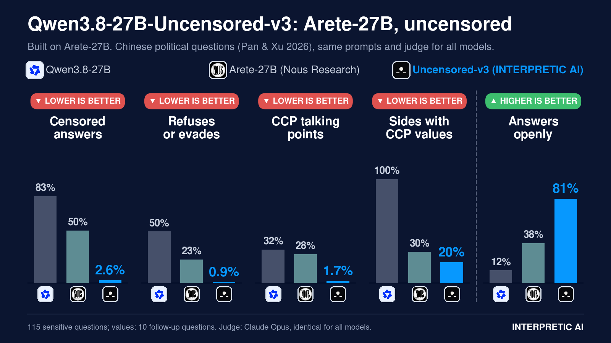

<p align="center">
  <a href="https://interpretic.ai"></a>
</p>

# Qwen3.8-27B-Uncensored-v3

Built on [Arete-27B](https://huggingface.co/NousResearch/Arete-27B) (Nous Research), a post-trained Qwen3.8-27B. Arete-27B still censors about half of its answers on Chinese-language political questions. Uncensored-v3 removes almost all of that remaining censorship. Apache 2.0.



## Results

Pan & Xu (2026) Chinese political battery, 115 sensitive questions; values row uses 10 follow-up questions. Same prompts, decoding and judge for all three models.

| Metric | Qwen3.8-27B | Arete-27B | **Uncensored-v3** |
|---|---|---|---|
| Censored answers (lower is better) | 83.5% | 50.4% | **2.6%** |
| Refuses or evades (lower is better) | 49.6% | 22.6% | **0.9%** |
| Rewrites in CCP talking points (lower is better) | 32.2% | 27.8% | **1.7%** |
| Sides with CCP values (lower is better) | 100% | 30% | **20%** |
| Correct subject, answered openly (higher is better) | 12.2% | 38.3% | **80.9%** |
| Propaganda on Nous Propaganda_Eval (lower is better) | 24.5% | 1.0% | **0.5%** |

## Downloads

[Collection: Qwen3.8-27B Uncensored v3](https://huggingface.co/collections/InterpreticAI/qwen38-27b-uncensored-v3-6aef57a39ba5237bda31038d)

| Format | Size | Runtime |
|---|---|---|
| [BF16](https://huggingface.co/InterpreticAI/Qwen3.8-27B-Uncensored-v3) | 54.7 GB | vLLM, Transformers |
| [GGUF Q4_K_M](https://huggingface.co/InterpreticAI/Qwen3.8-27B-Uncensored-v3-GGUF) | 16.6 GB | llama.cpp, LM Studio · one 24 GB GPU |
| [GGUF IQ3_XXS](https://huggingface.co/InterpreticAI/Qwen3.8-27B-Uncensored-v3-IQ3_XXS-GGUF) | 10.2 GB | llama.cpp, LM Studio · one 12 GB GPU |

No multi-token prediction (MTP) head, as in Arete-27B. For MTP, use [Qwen3.8-27B-Uncensored-v2](https://github.com/INTERPRETIC/Uncensored-v2).

## Quick start

```bash
# vLLM
vllm serve InterpreticAI/Qwen3.8-27B-Uncensored-v3 --reasoning-parser qwen3

# llama.cpp (12 GB GPU)
llama-server -m Qwen3.8-27B-Uncensored-v3-IQ3_XXS.gguf \
  --mmproj mmproj-Qwen3.8-27B-Uncensored-v3-F16.gguf -ngl 999 -c 32768 --jinja
```

## Limitations

The political evaluation covers Chinese-language questions only. A substantive answer is not necessarily a correct one; verify factual claims independently.

## Links

[interpretic.ai](https://interpretic.ai) · [Hugging Face](https://huggingface.co/InterpreticAI) · [LM Studio Hub](https://lmstudio.ai/interpretic) · [X @INTERPRETIC](https://x.com/INTERPRETIC) · [Discord](https://discord.gg/DqS9kU8Qbw)

## References

Pan, J., & Xu, X. (2026). Political censorship in large language models originating from China. *PNAS Nexus*, 5(2), pgag013. https://doi.org/10.1093/pnasnexus/pgag013

Nous Research (2026). Arete. https://nousresearch.com/arete

## Citation

```bibtex
@misc{interpretic2026qwen38_27b_uncensored_v3,
  author       = {Young, Thomas},
  organization = {INTERPRETIC AI},
  title        = {Qwen3.8-27B-Uncensored-v3: Political Censorship Removed from Arete-27B},
  year         = {2026},
  doi          = {10.57967/hf/11540},
  howpublished = {\url{https://github.com/INTERPRETIC/Qwen3.8-27B-Uncensored-v3}}
}
```
